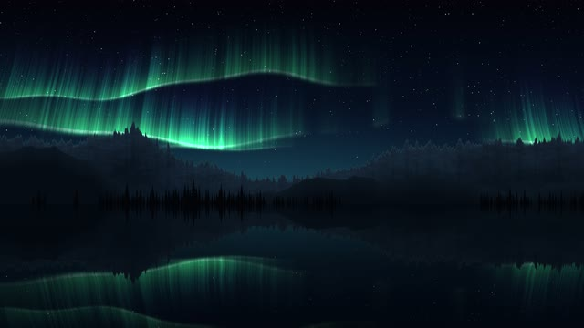
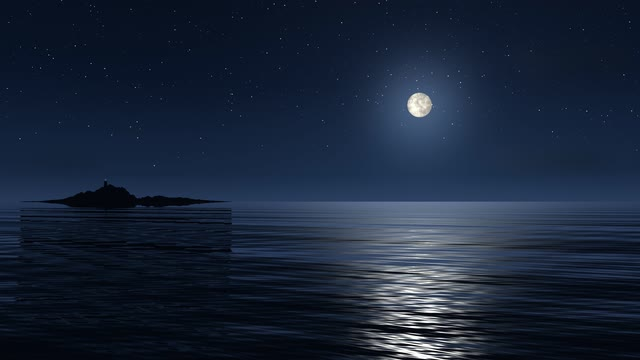
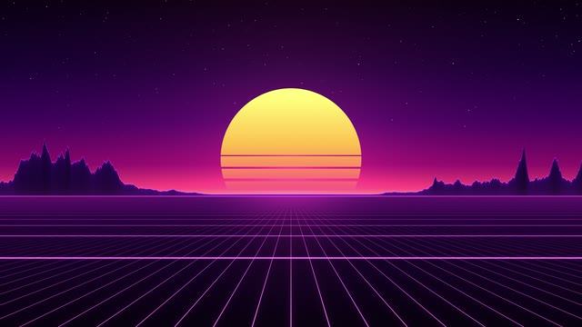
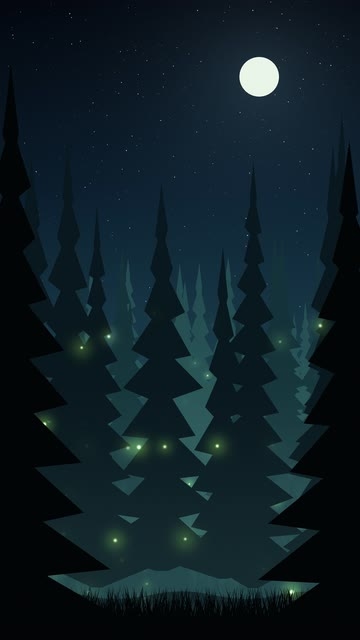
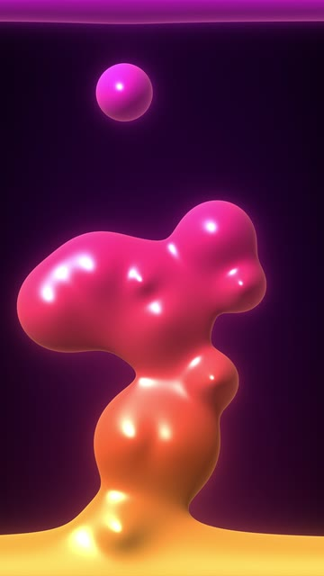
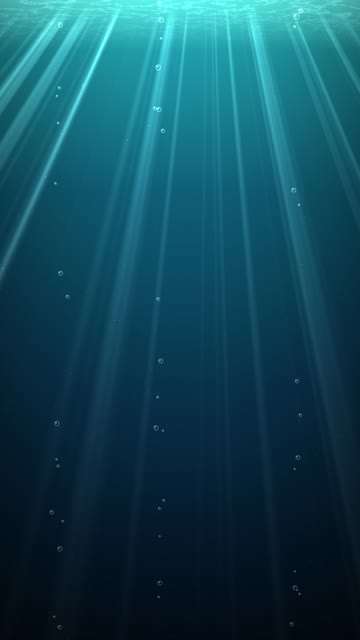

# Wallpaper Bank

A **4K-only** wallpaper bank for [JaKooLit's Hyprland-Dots](https://github.com/JaKooLit/Hyprland-Dots), now with seamless-looping live wallpapers for landscape and portrait monitors. If you use the dots, copy `wallpapers/` to `~/Pictures/wallpapers/`.

> 🎏 The still images are not mine. All credit goes to the artists and photographers who made them. The live wallpapers are original: they are rendered procedurally by [`scripts/generate-live-wallpapers.py`](scripts/generate-live-wallpapers.py), so there's no third-party footage and no licence baggage.

## What's inside

| Folder | Contents | Used by |
| --- | --- | --- |
| `wallpapers/` | 4K stills (every image ≥ 3840×2160) | SUPER + W picker, auto wallpaper changer |
| `wallpapers/Dynamic-Wallpapers/Dark` | 4K stills for dark mode | theme switcher |
| `wallpapers/Dynamic-Wallpapers/Light` | 4K light counterparts | theme switcher |
| `wallpapers/Live-Wallpapers/Horizontal` | 3840×2160 MP4 loops | SUPER + W (via `mpvpaper`) |
| `wallpapers/Live-Wallpapers/Vertical` | 2160×3840 MP4 loops | portrait / rotated monitors |

**4K rule:** an image stays only if it fills a 3840×2160 screen (2160×3840 for portrait) without upscaling. Four images that were a few pixels short (≤ 2%) were resized up to the line. Nothing else below 4K remains.

## Live wallpapers

| | Horizontal · 3840×2160 | |
| :---: | :---: | :---: |
|  |  |  |
| **Aurora-Lake** · northern lights over a mountain lake, mirrored in rippling water | **Moonlit-Sea** · rolling night ocean, glittering moon path, blinking lighthouse | **Neon-Horizon** · retro sunset over an endless scrolling neon grid |

| | Vertical · 2160×3840 | |
| :---: | :---: | :---: |
|  |  |  |
| **Firefly-Forest** · misty pines, drifting and blinking fireflies | **Lava-Lamp** · glossy wax blobs rising and falling | **Sunlit-Depths** · sun shafts, marine snow and bubbles in deep water |

Every clip is a 20-second **seamless loop**: all motion is periodic in the clip length, so the step from the last frame back to the first is the same as any other frame step, and there is no jump when `mpv` loops. They're encoded for cheap playback rather than archival quality: H.264 High@5.1, yuv420p, 30 fps, BT.709, no audio track. Most GPUs from the last decade can decode them in hardware.

### Using them

SUPER + W already lists the MP4s (install `mpvpaper` first), but it plays the pick on **every** monitor (`mpvpaper '*'`). With a mixed landscape/portrait setup, run one instance per output instead (`hyprctl monitors` shows the names):

```bash
mpvpaper -p -o "no-audio --loop hwdec=auto" DP-1 ~/Pictures/wallpapers/Live-Wallpapers/Horizontal/Aurora-Lake-Horizontal.mp4
```

```bash
mpvpaper -p -o "no-audio --loop hwdec=auto" HDMI-A-1 ~/Pictures/wallpapers/Live-Wallpapers/Vertical/Firefly-Forest-Vertical.mp4
```

`-p` pauses playback whenever the compositor reports the wallpaper as hidden. Add `-a MAX` to pause behind fullscreen or maximized windows too. `hwdec=auto` hands decoding to the GPU. A monitor rotated with `transform` in `monitors.conf` gets a portrait surface, so the vertical clips fill it natively.

To make it stick, put the same lines in `~/.config/hypr/UserConfigs/Startup_Apps.conf` as `exec-once = mpvpaper ...`.

> **Heads-up:** upstream's `WallpaperAutoChange.sh` feeds *every* path from `find "$1"` to `swww`, including folders and videos. When it lands on one, that slot is skipped for a full interval. Filtering for images fixes it: change `find "$1"` to `find "$1" -type f \( -iname '*.jpg' -o -iname '*.jpeg' -o -iname '*.png' -o -iname '*.webp' \)`.

### Make your own

The generator needs only `python3`, `numpy`, `pillow` and `ffmpeg`:

```bash
scripts/generate-live-wallpapers.py --list
```

```bash
scripts/generate-live-wallpapers.py all
```

```bash
scripts/generate-live-wallpapers.py moonlit-sea --size 5120x1440 --seconds 30
```

```bash
scripts/generate-live-wallpapers.py lava-lamp --preview 0.25 --out /tmp/previews
```

Any scene renders at any size or orientation (ultrawide, 5K, phone), and the output is always loop-perfect. `--preview` writes quick PNG stills instead of video.

## Keeping it 4K

Run the linter before adding anything:

```bash
scripts/check-wallpapers.py
```

It fails on anything below 4K, on mismatched extensions, and on whitespace-padded or duplicate file names (WallpaperSelect resolves a pick with `find -iname "<name>.*"`, so two files sharing a name collide). Videos are also checked for H.264/yuv420p.

## Sources

[Alphacoders](https://alphacoders.com) <br>
[Wallhaven](https://wallhaven.cc/) <br>
[Wallpaper-clan](https://wallpapers-clan.com/)
